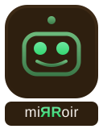
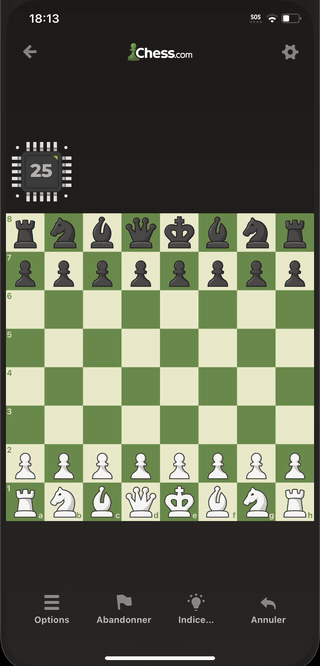

<p align="center">
  
</p>

# mirroir-mcp

[](https://www.npmjs.com/package/mirroir-mcp)
[](https://github.com/jfarcand/mirroir-mcp/actions/workflows/build.yml)
[](LICENSE)
[](https://support.apple.com/en-us/105071)
[](https://discord.gg/jVDBbMjPMf)

### Let your agent use your real iPhone, then replay what it did without an LLM.

<p align="center">
  
</p>
<p align="center"><em>A real run on a real iPhone, sped up: the agent reads the ETA in Waze, then posts it in Slack.</em></p>

No Developer Mode, no Xcode, no WebDriverAgent, no jailbreak. mirroir-mcp works through macOS iPhone Mirroring, so it reaches any app on your phone, including App Store apps you could never build. It works from any MCP client, with [39 tools](docs/tools.md).

## Quick start

You need macOS 15 or later and an iPhone connected through [iPhone Mirroring](https://support.apple.com/en-us/105071). Paste this into your coding agent (Claude Code, Codex, Cursor, OpenClaw, …):

```text
Set up mirroir-mcp so you can drive my iPhone: follow https://github.com/jfarcand/mirroir-mcp/blob/main/docs/onboarding.md step by step, and finish by reading back what my iPhone screen shows.
```

Or install it yourself:

```bash
npx -y mirroir-mcp install    # or: brew tap jfarcand/tap && brew install mirroir-mcp
npx -y mirroir-mcp doctor     # names anything left to fix
```

OpenClaw, Claude Desktop, Cursor, VS Code and the other clients: [Install](docs/install.md).

Then ask for something:

```
Open Calendar, create a new event called "Dentist" next Tuesday at 2pm.
```

```
Open my Expo Go app, tap "LoginDemo", test the login screen with
test@example.com / password123. Screenshot after each step.
```

```
Start recording, open Instagram, scroll the feed and open my profile, stop recording.
```

## Why mirroir

- **Nothing to install on the phone.** The iPhone stays stock: no signing, no provisioning profile, no on-device agent. If iPhone Mirroring shows it, mirroir can drive it.
- **Your Mac stays yours.** Taps and typing reach the mirror without bringing it to the front, so you can keep working. Swipes and drags still bring it to the front.
- **Explore once, replay without an LLM.** `generate_skill` explores an app and writes [SKILL.md](docs/skills-and-ci.md#skills) files. A compiled skill replays from the CLI with no AI in the loop (`mirroir test`), so CI runs are deterministic and cost no tokens.
- **Drift fails loudly.** [`mirroir-run`](docs/mirroir-run.md) has a third verdict beside pass and fail: `DRIFT`, exit code **65**, when every assertion held but the output moved past its baseline. Your CI lane decides whether drift blocks a merge.
- **It plays games, too.** A `scene:` step plays a turn-based or tap-driven game, frame by frame, under a hard budget. See [Games](docs/games.md).

  

  *A real game on a real iPhone, sped up 30×: the model reads the board, Stockfish picks the moves, mirroir plays them against Chess.com's strongest bot.*

- **One scenario, many surfaces.** A single `mirroir-run` scenario can drive the iPhone, a browser, HTTP endpoints and subprocesses, then compare what the page and the phone showed. See [Web and iOS in one scenario](docs/web-and-ios.md).

### How it compares

| | mirroir | [Maestro](https://github.com/mobile-dev-inc/Maestro) | [mobile-mcp](https://github.com/mobile-next/mobile-mcp) | [Appium](https://github.com/appium/appium) |
|---|---|---|---|---|
| Physical iPhone, no Developer Mode or signing | Yes — stock phone via iPhone Mirroring | No — its README: *"Physical iOS devices are not yet supported."* | USB-connected, trusted device (see its README) | No — WebDriverAgent via Xcode, Developer Mode |
| App Store apps you can't build | Yes | No — iOS runs on simulator builds | Yes | Yes, on a provisioned device |
| Replay without an LLM | Yes — compiled skills, `mirroir test` | Yes — YAML flows | No — the agent drives every run | Yes — test code |
| Distinct drift verdict | Yes — `DRIFT`, exit 65 | No — pass / fail | No | No — pass / fail |
| One scenario across iPhone + web + HTTP | Yes — `mirroir-run` | Web in the same flow syntax | No | Via your own test code |
| Android | No — an emulator window can be driven only as a generic macOS window | Yes | Yes | Yes |
| iOS Simulator | No | Yes | Yes | Yes |

Each tool has strengths the table doesn't capture. Maestro, mobile-mcp and Appium cover Android and simulators, which mirroir doesn't. mirroir is built for the case they leave open: a real, unmodified iPhone running apps you don't build.

## Safety

Giving an AI access to your phone demands defense in depth, so mirroir-mcp is **fail-closed**.

- **Read-only until you say otherwise.** Without a config file, only the 12 read-only tools are exposed. Every tool that changes something stays hidden from the client until you allow it in [`permissions.json`](docs/permissions.md).
- **Sensitive apps can be blocked.** `blockedApps` keeps the AI out of apps like Wallet or Banking, even when other tools are allowed.
- **Passwords stay yours.** mirroir never presses a sheet that asks for a password or Touch ID, and it tells agents to ask you before sending, buying, deleting or changing a setting.
- **No root, no daemon, no telemetry.** It runs as your user with Screen Recording and Accessibility. The one network call it makes by default is a once-a-day version check against npm (`updateCheck: false` turns it off). What your agent reads from the screen goes to whichever model your client uses.
- **Kill switch.** Close iPhone Mirroring to stop all input instantly.

See [Security](docs/security.md) for the full threat model.

## Documentation

| | |
|---|---|
| [Install](docs/install.md) | Every install path, per-client setup, updating, uninstalling |
| [Onboarding](docs/onboarding.md) | Setup written for the agent: prerequisites, install, doctor, and a read-only proof |
| [Tools Reference](docs/tools.md) | All 39 tools, parameters, and input workflows |
| [How mirroir sees the screen](docs/screen-intelligence.md) | The observe, reason, act loop; OCR, icon detection, AI vision |
| [Skills, exploration and CI](docs/skills-and-ci.md) | APP.md, skills, `generate_skill`, `mirroir test`, compiled replay, AI diagnosis, patterns |
| [`mirroir-run`](docs/mirroir-run.md) | Replay across iPhone, web, HTTP and subprocesses; GitHub Actions; Maestro import |
| [Games](docs/games.md) | Shell and scene, the `scene:` step, game controls |
| [CLI Tools](docs/cli.md) | Recorder, doctor, keyboard layout |
| [Configuration](docs/configuration.md) | All settings: screen intelligence, input timing, exploration, AI providers |
| [FAQ](docs/faq.md) | Security, focus stealing, keyboard layouts, embacle/vision mode |
| [Security](docs/security.md) | Threat model, kill switch, and recommendations |
| [Permissions](docs/permissions.md) | Fail-closed permission model and config file |
| [Known Limitations](docs/limitations.md) | Focus stealing, keyboard layout gaps, autocorrect |
| [Patterns & Skills](docs/components.md) | Element patterns, screen recipes, APP.md app descriptions, and the detection pipeline |
| [Exploring a New App](docs/exploring-a-new-app.md) | Step-by-step playbook for onboarding a new app — APP.md, permissions, components, exploration goal |
| [YOLO Icon Detection](docs/yolo-models.md) | Recommended YOLO models, CoreML setup, and configuration |
| [Compiled Skills](docs/compiled-skills.md) | Zero-OCR skill replay |
| [Testing](docs/testing.md) | FakeMirroring, integration tests, and CI strategy |
| [Web and iOS in one scenario](docs/web-and-ios.md) | How `mirroir-run` hands iOS blocks to `mirroir-mcp`, and how `cross_surface` compares a browser with a phone |
| [Cross-surface replay](runner/docs/) | `mirroir-run` scenario grammar, `.mirroir/` plan, `SAMPLE.md`, judge profiles, CI |
| [Troubleshooting](docs/troubleshooting.md) | Debug mode and common issues |
| [Contributing](CONTRIBUTING.md) | How to add tools, commands, and tests |
| [Skills Marketplace](docs/skills-marketplace.md) | Skill format, plugin discovery, and authoring |

## Community

Join the [Discord server](https://discord.gg/jVDBbMjPMf) to ask questions, share skills, and discuss ideas. Contributions are welcome: see [CONTRIBUTING.md](CONTRIBUTING.md). By submitting a patch, you agree to the [Contributor License Agreement](CLA.md); your Git commit metadata serves as your electronic signature.

---

> **Why "mirroir"?** — It's the old French spelling of *miroir* (mirror). A nod to the author's roots, not a typo.
