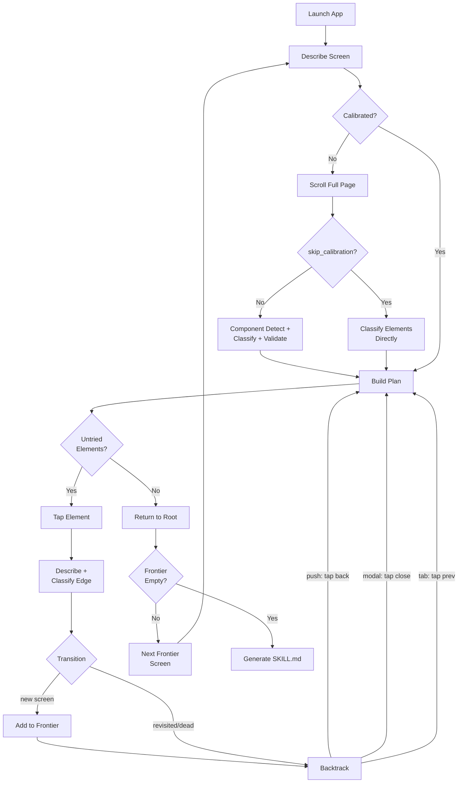

<p align="center">
  
</p>

# mirroir-mcp

[](https://www.npmjs.com/package/mirroir-mcp)
[](https://github.com/jfarcand/mirroir-mcp/actions/workflows/build.yml)
[](https://github.com/jfarcand/mirroir-mcp/actions/workflows/install.yml)
[](https://github.com/jfarcand/mirroir-mcp/actions/workflows/installers.yml)
[](https://github.com/jfarcand/mirroir-mcp/actions/workflows/mcp-compliance.yml)
[](LICENSE)
[](https://support.apple.com/en-us/105071)
[](https://discord.gg/jVDBbMjPMf)

### Let your agent use your real iPhone, then replay what it did without an LLM.

```
  ● you: "open Weather and tell me if it rains tomorrow"
  │
  ● describe_screen → "Weather" at (71, 149)
  │
  ● tap(71, 149) → describe_screen → forecast is up
  ✓ done, and the run can be saved as a skill that replays with no AI in the loop
```

**Drive a real, stock iPhone from any AI agent — no Developer Mode, no Xcode, no WebDriverAgent, no jailbreak.** mirroir-mcp works through macOS iPhone Mirroring, so it reaches any app on your phone, App Store apps you could never build included. Any MCP client, [39 tools](docs/tools.md), and experimental support for macOS app windows.

Give your AI eyes, hands, and a real iPhone: it sees the screen, taps what it needs, and figures the rest out.

## Why mirroir

- **Nothing to install on the phone.** The iPhone stays stock: no signing, no provisioning profile, no on-device agent. If iPhone Mirroring shows it, mirroir can drive it.
- **Explore once, replay without an LLM.** `generate_skill` explores an app and writes [SKILL.md](#skills) files. A compiled skill replays from the CLI with no AI in the loop (`mirroir test`), so CI runs are deterministic and cost no tokens.
- **Drift fails loudly.** [`mirroir-run`](#replay-anywhere-with-mirroir-run) has a third verdict beside pass and fail: `DRIFT`, exit code **65**, when every assertion held but the output moved past its baseline. Your CI lane decides whether drift blocks a merge.
- **It plays games, too.** A `scene:` step plays a turn-based or tap-driven game, frame by frame, under a hard budget — on an unmodified App Store game you could never instrument. See [Vision: agents that test — and play](#vision-agents-that-test--and-play).
- **One scenario, many surfaces.** A single `mirroir-run` scenario can drive the iPhone, a browser (Playwright: chromium, firefox, webkit), HTTP endpoints and subprocesses, then compare what the page and the phone showed. Web, HTTP and process scenarios run on Linux CI; the iPhone leg runs on a Mac with iPhone Mirroring, and [FakeMirroring](docs/testing.md) stands in for the phone in CI.

### How it compares

| | mirroir | [Maestro](https://github.com/mobile-dev-inc/Maestro) | [mobile-mcp](https://github.com/mobile-next/mobile-mcp) | [Appium](https://github.com/appium/appium) |
|---|---|---|---|---|
| Physical iPhone, no Developer Mode or signing | Yes — stock phone via iPhone Mirroring | No — its README: *"Physical iOS devices are not yet supported."* | USB-connected, trusted device (see its README) | No — WebDriverAgent via Xcode, Developer Mode |
| App Store apps you can't build | Yes | No — iOS runs on simulator builds | Yes | Yes, on a provisioned device |
| Replay without an LLM | Yes — compiled skills, `mirroir test` | Yes — YAML flows | No — the agent drives every run | Yes — test code |
| Distinct drift verdict | Yes — `DRIFT`, exit 65 | No — pass / fail | No | No — pass / fail |
| One scenario across iPhone + web + HTTP | Yes — `mirroir-run` | Web in the same flow syntax | No | Via your own test code |
| Android | No — an emulator window can be driven only as a generic macOS window | Yes | Yes | Yes |
| iOS Simulator | No | Yes | Yes | Yes |

Each tool has strengths the table doesn't capture. Maestro, mobile-mcp and Appium cover Android and simulators, which mirroir doesn't. mirroir is built for the case they leave open: a real, unmodified iPhone running apps you don't build.

## Requirements

- macOS 15+
- iPhone connected via [iPhone Mirroring](https://support.apple.com/en-us/105071)

## Install

The fastest path: paste this into your coding agent (Claude Code, Codex, Cursor, …) and let it do the setup.

```text
Set up mirroir-mcp so you can drive my iPhone: follow https://github.com/jfarcand/mirroir-mcp/blob/main/docs/onboarding.md step by step, and finish by reading back what my iPhone screen shows.
```

Or install it yourself:

```bash
/bin/bash -c "$(curl -fsSL https://mirroir.dev/get-mirroir.sh)"
```

or via [npx](https://www.npmjs.com/package/mirroir-mcp):

```bash
npx -y mirroir-mcp install
```

or via [Homebrew](https://tap.mirroir.dev):

```bash
brew tap jfarcand/tap && brew install mirroir-mcp
```

or as a [Claude Code plugin](https://docs.claude.com/en/docs/claude-code/plugins):

```
/plugin marketplace add jfarcand/mirroir-mcp
/plugin install mirroir@mirroir
/plugin install skills@mirroir   # optional: the community skill library
```

or as an MCP Bundle for Claude Desktop and other MCPB hosts: download `mirroir-mcp.mcpb` from the [latest release](https://github.com/jfarcand/mirroir-mcp/releases/latest) (v0.43.0 and later) and double-click it. The bundle carries the native Apple Silicon binary, so it needs no Node.js. To build one from a release build: `mcpb/build-mcpb.sh .build/release/mirroir-mcp mirroir-mcp.mcpb`.

The first time you take a screenshot, macOS will prompt for **Screen Recording** and **Accessibility** permissions. Grant both. `mirroir doctor` names the app that needs each grant and links the System Settings pane to open.

Every MCP client receives a short operating manual in the server instructions. For the full version as a skill (Claude Code and Codex), run `npx -y mirroir-mcp skill --install`; `npx -y mirroir-mcp install` does it when it configures either client.

<details>
<summary>Per-client setup</summary>

#### Claude Code

```bash
claude mcp add --transport stdio mirroir -- npx -y mirroir-mcp
```

#### GitHub Copilot (VS Code)

Install from the MCP server gallery: search `@mcp mirroir` in the Extensions view, or add to `.vscode/mcp.json`:

```json
{
  "servers": {
    "mirroir": {
      "type": "stdio",
      "command": "npx",
      "args": ["-y", "mirroir-mcp"]
    }
  }
}
```

#### Cursor

Add to `.cursor/mcp.json` in your project root:

```json
{
  "mcpServers": {
    "mirroir": {
      "command": "npx",
      "args": ["-y", "mirroir-mcp"]
    }
  }
}
```

#### OpenAI Codex

```bash
codex mcp add mirroir -- npx -y mirroir-mcp
```

Or add to `~/.codex/config.toml`:

```toml
[mcp_servers.mirroir]
command = "npx"
args = ["-y", "mirroir-mcp"]
```

#### Goose

Add to `~/.config/goose/config.yaml`:

```yaml
extensions:
  mirroir:
    name: mirroir
    cmd: npx
    args: [-y, mirroir-mcp]
    enabled: true
    type: stdio
    timeout: 300
```

#### Cline

Open **MCP Servers → Configure → Configure MCP Servers** and add to `cline_mcp_settings.json`:

```json
{
  "mcpServers": {
    "mirroir": {
      "command": "npx",
      "args": ["-y", "mirroir-mcp"],
      "disabled": false
    }
  }
}
```

</details>

<details>
<summary>Install from source</summary>

```bash
git clone https://github.com/jfarcand/mirroir-mcp.git
cd mirroir-mcp
./mirroir.sh
```

Use the full path to the binary in your `.mcp.json`: `<repo>/.build/release/mirroir-mcp`.

</details>

## How it works

Every interaction follows the same loop: **observe, reason, act**. `describe_screen` gives the AI every text element with tap coordinates (eyes). The LLM decides what to do next (brain). `tap`, `type_text`, `swipe` execute the action (hands) — then it loops back to observe. No scripts, no coordinates, just intent.

Beyond the basics, the server exposes higher-level navigation and lifecycle tools: `press_back` navigates back by OCR-tapping the "<" chevron (with a canonical-position fallback), `press_home`/`press_app_switcher`/`spotlight` drive system gestures, `scroll_to` scrolls until a target text becomes visible, `reset_app` force-quits an app via the App Switcher, `set_network` toggles connectivity through Settings, and `measure` times how long an action takes to surface a target element. Multi-target setups use `list_targets`/`switch_target` to move between window automation endpoints. Skill authoring is served by `record_step` and `save_compiled` (compiled replay) and `calibrate_component` (test a component definition against the live screen). See the [Tools Reference](docs/tools.md) for all 39 tools.

## Describe Your App

mirroir can explore any iOS app blindly, but it works better when you tell it what to expect. Write an `APP.md` file and mirroir reads it before exploration starts:

```markdown
---
app: Santé
archetype: dashboard
obstacle_mode: auto
---

## Structure
Dashboard with 4 tabs: Résumé, Partage, Parcourir, Profil.

## Résumé Tab
- Summary cards for health metrics that drill down to charts
- Cards often show "Aucune donnée" on test devices

## Obstacles
- Health Access permission → tap "Autoriser"
- Notification permission → tap "Ne pas autoriser"

## Skip
- Supprimer les données de Santé
- Réinitialiser
```

What the code actually uses today: `archetype` overrides recipe auto-detection; `obstacles` are auto-dismissed when `obstacle_mode: auto`; `skip` merges with `permissions.json.skipElements`; `tabs` (inline or as a section) are injected as high-priority targets; Structure + tab body + Tips become AI context in generated skills.

See the [APP.md specification](docs/APP.md.spec.md) for the complete field list, loader resolution rules, and the permission-system bridge. Three levels of patterns work together — elements (what rows look like), screens (what the page layout means), and apps (what the developer knows). [Patterns & Skills](docs/components.md) covers the full system.

## Examples

Paste any of these into Claude Code, Claude Desktop, ChatGPT, Cursor, or any MCP client:

```
Open Messages, find my conversation with Alice, and send "running 10 min late".
```

```
Open Calendar, create a new event called "Dentist" next Tuesday at 2pm.
```

```
Open my Expo Go app, tap "LoginDemo", test the login screen with
test@example.com / password123. Screenshot after each step.
```

```
Start recording, open Instagram, scroll the feed and open my profile, stop recording.
```

## Vision: agents that test — and play

mirroir is growing archetype-aware coverage for **games**. A game splits into two surfaces. The **shell** — menu, shop, loadout, settings, win/lose screens — is ordinary text-labelled UI that today's skills already drive. The **scene** — the playfield — is a vision-driven loop an agent follows one touch at a time. The honest targets are **game QA smoke tests, tutorial walkthroughs, and scripted demos**, not real-time play: iPhone Mirroring exposes a single pointer, so twin-stick and twitch games stay out of reach (see [Games](#games)).

**Token reductions** make the scene loop affordable. Screenshots are ~90% of an agent's cost, so text-rich shell screens read through `describe_screen` with no image at all, and a region/scale capture knob trims the per-frame image cost where a screenshot is unavoidable. On the playfield, `describe_screen` in vision mode sends the frame to an LLM through embacle; measured on a live Brawl Stars match, one frame costs ~24k prompt tokens and 3–14 s, which GitHub Copilot bills as a single premium request on Claude Sonnet 5.5.

The scene loop ships as the [`scene:` step](docs/skills-marketplace.md#scenes): a `kind: game` skill names its objective, its calibrated controls and its win/lose screens, and the vision model picks one control per frame until the game is won, lost, or the step's frame, token or time budget runs out. A run that exhausts its budget is inconclusive (exit 66), never a silent pass. A scene is never compiled: every frame is a fresh decision.

## Games

Games get three controls through iPhone Mirroring: `touch` holds a finger across calls for virtual joysticks and press-and-hold (`begin`, `move`, `end`); `hold_keys` holds keys such as `w` while dragging the right mouse button, for games that switch to keyboard and mouse controls like Roblox; `pinch` and `rotate` drive two-finger zoom and rotation in gesture-recognizer UIs. Mirroring exposes a single pointer touch to apps, so a touch-only game cannot receive two independent fingers — see [Games and Multi-Touch](docs/tools.md#games-and-multi-touch) for what was measured.

## Screen Intelligence

`describe_screen` is the AI's eyes. Three backends work together to give the agent a complete picture of what's on screen — text, icons, and semantic UI structure.

### Apple Vision OCR (default)

The default backend uses Apple's Vision framework to detect every text element on screen and return exact tap coordinates. This is fast, local, and requires no API keys or external services.

### Icon Detection (YOLO CoreML)

Text-only OCR misses non-text UI elements — buttons, toggles, tab bar icons, activity rings. Drop a YOLO CoreML model (`.mlmodelc`) in `~/.mirroir-mcp/models/` and the server auto-detects it at startup, merging icon detection results with OCR text. The AI gets tap targets for elements that text-only OCR cannot see.

| Mode | `ocrBackend` setting | Behavior |
|------|---------------------|----------|
| Auto-detect (default) | `"auto"` | Uses Vision + YOLO if a model is installed, Vision only otherwise |
| Vision only | `"vision"` | Apple Vision OCR text only |
| YOLO only | `"yolo"` | CoreML element detection only |
| Both | `"both"` | Always merge both backends (falls back to Vision if no model) |

### AI Vision Mode (embacle)

Instead of local OCR, `describe_screen` can send the screenshot to an AI vision model that identifies UI elements semantically — cards, tabs, buttons, icons, navigation structure — not just raw text. This produces richer context for the agent, especially on screens with complex layouts.

The [embacle](https://github.com/dravr-ai/dravr-embacle) runtime is embedded directly into the mirroir-mcp binary via Rust FFI. `describe_screen` calls the embedded runtime in-process — no separate server, no network round-trip, no additional setup. The FFI layer (`EmbacleFFI.swift` → `libembacle.a`) handles initialization, chat completion requests, and memory management across the Swift/Rust boundary.

embacle routes vision requests through already-authenticated CLI tools (GitHub Copilot, Claude Code) so there is no separate API key to manage. If you have a Copilot or Claude Code subscription, you already have access.

#### Install

```bash
brew tap dravr-ai/tap
brew trust --tap dravr-ai/tap # recent Homebrew refuses to load untrusted taps
brew install embacle          # CLI tools (embacle-server, embacle-mcp)
brew install embacle-ffi      # Rust FFI static library (libembacle.a)
```

Both are optional. Without `embacle-ffi` the build links against Apple Vision
and `describe_screen` uses local OCR.

Then rebuild mirroir-mcp from source (or reinstall via Homebrew) so the binary links against `libembacle.a`:

```bash
# From source
swift build -c release

# Or via Homebrew (rebuilds automatically)
brew reinstall mirroir-mcp
```

#### Zero-config activation

When the embacle FFI is linked into the binary, `screenDescriberMode` defaults to `"auto"` which automatically resolves to vision mode. No settings change required — install embacle-ffi, rebuild, and `describe_screen` starts using AI vision.

To force local OCR even when embacle is available, explicitly set `"ocr"`:

```json
// .mirroir-mcp/settings.json
{
  "screenDescriberMode": "ocr"
}
```

See [Configuration](#configuration) for all available settings.

## Skills

When you find yourself repeating the same agent workflow, capture it as a skill. Skills are SKILL.md files — numbered steps the AI follows, adapting to layout changes and unexpected dialogs. Steps like `Tap "Email"` use OCR — no hardcoded coordinates.

Place files in `~/.mirroir-mcp/skills/` (global) or `<cwd>/.mirroir-mcp/skills/` (project-local).

### APP.md

Describe your app's structure to guide exploration — see [Describe Your App](#describe-your-app) above and the full [APP.md specification](docs/APP.md.spec.md). Place APP.md files in `~/.mirroir-mcp/skills/` or the [mirroir-skills](https://github.com/jfarcand/mirroir-skills) repo at `patterns/apps/`.

```markdown
---
version: 1
name: Commute ETA Notification
app: Waze, Messages
tags: ["workflow", "cross-app"]
---

## Steps

1. Launch **Waze**
2. Wait for "Où va-t-on ?" to appear
3. Tap "Où va-t-on ?"
4. Wait for "${DESTINATION:-Travail}" to appear
5. Tap "${DESTINATION:-Travail}"
6. Wait for "Y aller" to appear
7. Tap "Y aller"
8. Wait for "min" to appear
9. Remember: Read the commute time and ETA.
10. Press Home
11. Launch **Messages**
12. Tap "New Message"
13. Type "${RECIPIENT}" and select the contact
14. Type "On my way! ETA {eta}"
15. Press **Return**
16. Screenshot: "message_sent"
```

`${VAR}` placeholders resolve from environment variables. `${VAR:-default}` for fallbacks.

### Skill Marketplace

Install ready-to-use skills from [jfarcand/mirroir-skills](https://github.com/jfarcand/mirroir-skills):

```bash
git clone https://github.com/jfarcand/mirroir-skills ~/.mirroir-mcp/skills
```

## From Exploration to CI

The `generate_skill` tool lets an AI agent explore an app and produce SKILL.md files. It uses [breadth-first search](https://en.wikipedia.org/wiki/Breadth-first_search) (BFS) to traverse the app as a navigation graph — screens are nodes, tappable elements are edges. The explorer describes each screen, matches elements against [component definitions](#component-detection) to decide what to tap, visits child screens, and backtracks via the back chevron. Duplicate screens are skipped via structural fingerprinting. See [Component Detection](#component-detection) below for how the explorer interprets raw elements into structured UI components.

The explorer works viewport-by-viewport: after calibrating the page length, it builds a plan from the current viewport, taps elements top-to-bottom, scrolls down to reveal more content, and rebuilds the plan for each new viewport. This approach works with both OCR and AI vision describers. Pass `seed` for deterministic ordering across runs.

Exploration is bounded — it does not discover every reachable screen in large apps. Depth, screen count, and time limits keep runs practical. For targeted flows, provide a `goal` to focus the traversal.



### Generate

Two modes: **autonomous exploration** (BFS) and **guided session** (manual step-by-step).

**Autonomous BFS exploration** — the agent explores on its own:

```
Explore the Settings app and generate a skill that checks the iOS version.
```

This calls `generate_skill(action: "explore", app_name: "Settings", goal: "check iOS version")` under the hood. The explorer launches the app, runs BFS from the root screen, and outputs a SKILL.md for the discovered path.

| Parameter | Default | Description |
|-----------|---------|-------------|
| `app_name` | required | App to explore |
| `goal` | none | Focus exploration toward a specific flow (e.g. "check software version") |
| `goals` | none | Array of goals — one SKILL.md per goal |
| `max_depth` | 6 | Maximum BFS depth |
| `max_screens` | 30 | Maximum screens to visit |
| `max_time` | 300 | Maximum seconds before stopping |
| `strategy` | auto | `"mobile"` (default), `"social"` (Reddit, Instagram, TikTok), or `"desktop"` (macOS windows) |
| `explorer` | `bfs` | Exploration algorithm: `"bfs"` (breadth-first, default) or `"dfs"` (depth-first) |
| `skip_calibration` | false | Skip component detection during calibration. Scrolling still runs. Useful with AI vision describers that produce clean semantic elements |
| `seed` | random | Integer seed for deterministic exploration ordering. Same seed produces identical tap sequences |
| `fresh` | true | Discard persisted navigation graph and explore from scratch. Set `false` for incremental exploration |

**Guided session** — the AI navigates manually, capturing each screen:

1. `generate_skill(action: "start", app_name: "MyApp")` — launch app, OCR first screen
2. Use `tap`/`swipe`/`type_text` to navigate, then `generate_skill(action: "capture")` to record each screen
3. `generate_skill(action: "finish")` — assemble captured screens into a SKILL.md

### Test

Run skills deterministically from the CLI — no AI in the loop. A YAML skill runs its own steps. A SKILL.md's body is prose for an AI, so it runs the steps recorded in its `.compiled.json` when an MCP client first ran it (`get_skill`, then `record_step` after each step and `save_compiled` at the end). An uncompiled SKILL.md is refused with that instruction, one edited since it was compiled is refused as stale, and a run with no skill arguments skips any SKILL.md that has no compiled file:

```bash
mirroir test apps/settings/check-about
mirroir test --junit results.xml --verbose        # JUnit output
mirroir test --dry-run apps/settings/check-about    # validate without executing
```

| Option | Description |
|---|---|
| `--junit <path>` | Write JUnit XML report |
| `--report-json <path>` | Write a Playwright JSON-reporter document — the format `mirroir-run` ingests |
| `--capture <key>` | Attach each skill's final-screen OCR text to the `--report-json` document under `cross_surface.<key>`, with the structural fingerprint of the start screen and of each step's settled screen under `screens` (`start`, `0`, `1`, …) and the window under `device` |
| `--compiled-out <path>` | After the one skill given passes, write its `.compiled.json` to `<path>`: each step that ran as a passthrough step carrying the screen it left (`arrivalFingerprint`), the start screen as `screenFingerprint`. A failed run, or a pass whose start screen or any step's screen could not be read, writes nothing and exits `1`. Needs `--compiled-source`; refused with `--dry-run` or more than one skill |
| `--compiled-source <file>` | The file whose SHA-256 the `--compiled-out` skill records as its source — the scenario `mirroir-run` rendered the skill from |
| `--screenshot-dir <dir>` | Save failure screenshots (default: `./mirroir-test-results/`) |
| `--timeout <seconds>` | `wait_for` timeout (default: 15) |
| `--verbose` | Step-by-step detail |
| `--dry-run` | Parse and validate without executing (refused with `--report-json`: a dry run has no verdict to report) |
| `--confirm-destructive` | Run steps that send, remove, spend, or reset something on the device. Without it, a run holding one is refused before any step executes, naming each. `reset_app:` counts as destructive except when the very next step is a `launch:` of the same app (exact name, case-sensitive after trimming): that pair only returns the app about to be driven to its root, the way every emitted `.ios.yaml` flow opens |
| `--no-compiled` | Skip compiled skills, force full OCR |
| `--agent <name>` | AI diagnosis of a failed step (see [AI-Assisted Diagnosis](#ai-assisted-diagnosis)) |

Exit code `0` = all pass, `1` = any failure, `2` = refused arguments (an unknown option is named, never ignored). A skill whose every step was skipped is a failure, and a skill holding a step the parser cannot read (an unknown verb, a malformed `target:`) or cannot use (a `drag:` naming neither end, a `measure:` with no action) is refused before anything runs, `--dry-run` included. A skill holding an AI-only step (`verify`, `remember`, `condition`, `repeat`, `summarize`) fails with `not evaluated: <step> needs an AI client`: the CLI has no AI to check it, so it never reports that skill as passed.

`mirroir test` only reads `.compiled.json` files, never rewrites them; it writes one only to the path `--compiled-out` names. A compiled file stale for its source, format version or window size is named and the skill runs on live OCR.

### Compiled Skills

Compile a skill once to capture coordinates and timing. Replay skips OCR for every step with a recorded hint; assertions still re-check the screen, and steps without a hint run live.

```bash
mirroir compile apps/settings/check-about        # compile
mirroir test apps/settings/check-about            # auto-detects .compiled.json
mirroir test --no-compiled check-about            # force full OCR
```

`mirroir compile` re-records coordinates by running a skill's steps on the device. For a SKILL.md those are the steps in its existing `.compiled.json`, so the first compile of a SKILL.md always happens through an MCP client.

An AI agent compiles a skill on its first MCP run by calling `record_step` after each step and `save_compiled` at the end. See [Compiled Skills](docs/compiled-skills.md) for details.

Two different files are named `.compiled.json`. The one next to a skill, written by `save_compiled` or `mirroir compile`, is the speed cache `mirroir test` replays. The `<scenario>.compiled.json` next to an `.ios.yaml` in a consumer repo's `.mirroir/` is the screen-drift baseline `mirroir-run` records itself on a passing run; the runner never replays from it, every `ios` block runs live. So `save_compiled` with `emit: true` writes the skill's `.compiled.json` and a `.mirroir/` scenario, never a `.compiled.json` into `.mirroir/`.

### AI-Assisted Diagnosis

When a test step fails, pass `--agent` to get an AI diagnosis of what went wrong and suggested fixes:

```bash
mirroir test --agent gpt-5.3 apps/settings/check-about
mirroir test --agent claude-sonnet-5-5 apps/settings/check-about
mirroir test --agent ollama:llama3 apps/settings/check-about
mirroir test --agent embacle apps/settings/check-about
```

Built-in agents:

| Agent | Provider | API Key |
|-------|----------|---------|
| `gpt-5.3` | OpenAI | `OPENAI_API_KEY` |
| `claude-opus-5-5`, `claude-sonnet-5-5`, `claude-haiku-5-5` | Anthropic | `ANTHROPIC_API_KEY` |
| `ollama:<model>` | [Ollama](https://ollama.com) (local) | None |
| `embacle`, `embacle:claude` | [embacle-server](https://github.com/dravr-ai/dravr-embacle) | CLI agent key |

How a request reaches its agent: Anthropic, OpenAI and Ollama agents always call their own HTTP API. An `embacle` agent whose model is a bare Copilot model id (`embacle` sends `claude-sonnet-5.5`) runs on the embedded embacle runtime when `libembacle` is linked and `agentTransport` is not `"http"`, and over HTTP to `base_url` otherwise. An embacle model in embacle-server's `runner:model` form always goes over HTTP, because the embedded runtime is the Copilot runner only: `embacle:claude` sends `claude:sonnet`, which selects embacle-server's Claude Code runner, so it needs `embacle-server` listening on `http://localhost:3000`. A bare runner name as the model (`claude`, `copilot`, …) means that runner's default model and also goes over HTTP.

Custom agents are defined as YAML profiles in `<cwd>/.mirroir-mcp/agents/<name>.yaml` (project-local) or `~/.mirroir-mcp/agents/<name>.yaml` (global, project-local wins). Pass the file's `<name>` to `--agent`.

A profile runs in one of two modes:

**`mode: api`** — call a cloud or local HTTP endpoint:

```yaml
# ~/.mirroir-mcp/agents/my-gpt.yaml
mode: api
provider: openai          # anthropic | openai | ollama | embacle
model: gpt-5.3
api_key_env: OPENAI_API_KEY
base_url: https://api.openai.com
system_prompt: "You are a terse iOS automation debugger."
max_tokens: 4096
```

**`mode: command`** — run a local CLI process (e.g. an already-authenticated `claude -p` / `copilot -p`, or a custom script). The diagnostic payload is delivered two ways: if any `args` entry contains `${PAYLOAD}`, the JSON payload is substituted there; otherwise it is piped to the command's stdin:

```yaml
# ~/.mirroir-mcp/agents/claude-cli.yaml
mode: command
command: claude
args: ["-p", "${PAYLOAD}"]
system_prompt: "Diagnose the failed step and reply with JSON."
```

| Key | Mode | Description |
|---|---|---|
| `mode` | both | `api` (default) or `command` |
| `provider` | api | `anthropic`, `openai`, `ollama`, or `embacle` |
| `model` | api | Model identifier |
| `api_key_env` | api | Environment variable holding the API key |
| `base_url` | api | Endpoint base URL |
| `command` | command | Executable to launch (`PATH`-resolved, or an absolute path) |
| `args` | command | Argument array; `${PAYLOAD}` is replaced with the JSON payload |
| `system_prompt` | both | System prompt sent with the request |
| `max_tokens` | both | Response token budget |

<details>
<summary>No API key? Use embacle</summary>

[embacle](https://github.com/dravr-ai/dravr-embacle) routes requests through already-authenticated CLI tools (GitHub Copilot, Claude Code, etc.) — no separate API key needed:

```bash
brew tap dravr-ai/tap && brew trust --tap dravr-ai/tap && brew install embacle
mirroir test --agent embacle my-skill
```

</details>

### Pattern System

The explorer uses a three-layer pattern system to understand iOS apps — the same declarative concept at different scales:

- **Element patterns** (`patterns/elements/`) — 34 definitions matching row-level UI components (table rows, tab bars, toggles, summary cards). Each specifies match rules, interaction behavior, and grouping logic.
- **Screen patterns** (`patterns/screens/`) — 7 archetype recipes that identify screen-level navigation models from element composition. Auto-detected during calibration, or declared via `archetype` in APP.md.
- **App patterns** (`patterns/apps/`) — APP.md files with structure, obstacles, skip lists, and archetype declarations. The developer's source of truth.

Built-in archetypes: `settings-list`, `dashboard`, `social-feed`, `content-grid`, `conversation-list`, `utility-display`, `detail-form`.

Place custom patterns in `~/.mirroir-mcp/components/` (elements), `~/.mirroir-mcp/recipes/` (screens), or the [mirroir-skills](https://github.com/jfarcand/mirroir-skills) repo.

#### Vision Indicators

AI vision describers describe UI elements semantically ("Activité chevron") rather than character-by-character ("Activité" + ">"). A `vision-indicators.md` file maps these descriptions to OCR-compatible characters so the component pipeline works identically with both backends:

```markdown
## Indicators
- chevron: >
- dismiss: ×
- back: <
```

When a vision element ends with a mapped suffix (e.g. "Entraînements chevron"), the normalizer splits it into two elements: "Entraînements" + ">". Place `vision-indicators.md` alongside your component definitions.

See [Component Detection](docs/components.md) for the full definition format, match rule reference, and the detection pipeline.

## Replay anywhere with `mirroir-run`

`mirroir-mcp` drives the iPhone — AX + OCR + BFS exploration. `mirroir-run` replays `.mirroir/` SkillStep scenarios against **web, process, HTTP, and iOS** surfaces: web through Playwright, subprocesses and HTTP natively, and each `target: { kind: ios }` block handed to `mirroir-mcp test` on a Mac with iPhone Mirroring connected. Both read one SkillStep grammar, so a single scenario can drive a browser and a phone and check that they show the same thing. A single Rust binary (`runner/` in this repo); web, process and HTTP scenarios run on Linux CI with no macOS dependency. How the two binaries meet: [Web and iOS in one scenario](docs/web-and-ios.md).

Drop a `.mirroir/` directory in any repo and `mirroir-run` discovers it from the working directory:

```
your-app/
└── .mirroir/
    ├── mirroir.yaml          # the plan: must-pass / nice-to-pass entries
    └── apps/<sample>/
        ├── SAMPLE.md         # how to boot the app under test
        ├── APP.md            # structure, obstacles, skip lists
        └── scenarios/*.yaml  # SkillStep flows to replay
```

```bash
cd your-app
mirroir-run                          # discover .mirroir/, replay the must-pass plan
mirroir-run --scenarios all          # include nice-to-pass entries too
```

Each plan entry either points at a `local:` sample tree or extends a shared **archetype** (`archetypes: ["<pack>/<name>@<ver>"]`) with per-instance `vars:` and `boot:`. An archetype captures a reusable app shape — say, an AI chat console — once, and parameterizes it per app.

**Where the iOS leg comes from.** `generate_skill … emit=true` (on `finish` or `explore`), `save_compiled … emit=true` (a skill an AI ran step by step) and `mirroir record` (a walk driven by hand) each write the flow into `.mirroir/apps/<app>/` as a runnable iOS leg: a `target: { kind: ios }` scenario, a `SAMPLE.md` declaring it, and a `must_pass` plan entry. `mirroir-run` hands each `ios` block to `mirroir-mcp test` on a macOS host with iPhone Mirroring connected, and refuses it by name on any other host. Run the MCP from your consumer repo (or pass `output_dir`) so the tree lands in the right `.mirroir/`; emitting into `~/.mirroir` (the runner's pack home) is refused. One scenario can hold both legs: a `web` block, an `ios` block, and a `cross_surface:` step whose `captures:` record the page's scrape and the phone's final screen live, then compare them — the run that checks the gate produces both halves. See [`runner/docs/mirroir-dotfile.md`](runner/docs/mirroir-dotfile.md).

Web steps compile to a Playwright `.spec.ts` and run across chromium, firefox, and webkit. Selectors resolve three ways: raw CSS, Playwright engine prefixes (`role=button[name="Save"]`, `text=Welcome`, `xpath=…`), or a bare label resolved in Playwright's own priority — role, label, placeholder, `data-test`, visible text. Every compiled spec also collects uncaught page errors and failed responses, so a page that throws is a failure even when every locator resolved. The spec, its config, and the trace / video / screenshot of a failure persist under `target/playwright/<sample>/<scenario>/`. Process and HTTP steps dispatch natively; an LLM judge step scores agent responses against expected signals, and drift detection catches output divergence vs. a baseline.

| Mode | Command |
|---|---|
| Validate a scenario against the grammar | `mirroir-run --validate scenario.yaml` |
| Compile the Playwright spec to disk | `mirroir-run --emit playwright scenario.yaml` |
| Run one scenario end-to-end | `mirroir-run --run-scenario scenario.yaml` |
| Boot a sample dir, run its scenarios | `mirroir-run --sample .mirroir/apps/foo` |
| Hand an iOS block to a specific `mirroir-mcp` | `MIRROIR_MCP_BIN=/path/to/mirroir-mcp mirroir-run …` |
| Standalone text drift check | `mirroir-run --diff-text a.txt b.txt` |

### Install `mirroir-run`

```bash
# crates.io
cargo install mirroir-run

# Homebrew
brew install jfarcand/tap/mirroir-run
```

Prebuilt binaries for macOS (Intel + Apple Silicon), Linux (gnu + musl), and Windows are attached to each [`runner-v*` release](https://github.com/jfarcand/mirroir-mcp/releases). On Windows, subprocess teardown signals are not implemented, so process scenarios are not supported there. See [`runner/docs/`](runner/docs/) for the scenario grammar, `SAMPLE.md` schema, judge profiles, and CI integration.

### Use `mirroir-run` in GitHub Actions

```yaml
- uses: jfarcand/mirroir-mcp/actions/setup-mirroir-run@main
  with:
    version: latest   # or pin: 0.4.0
- run: mirroir-run    # replays the nearest .mirroir/mirroir.yaml
```

Installs the released `mirroir-run` binary (Linux x64, macOS arm64/x64, Windows x64), verifies its SHA-256 and adds it to `PATH`. Web scenarios also need Playwright: add `jfarcand/mirroir-mcp/.github/actions/setup-playwright@main`. See [`actions/setup-mirroir-run`](actions/setup-mirroir-run/README.md).

### Bring your Maestro flows

Maestro flows run on a real, stock iPhone through `mirroir-run`:

```bash
mirroir-run import maestro flows/*.yaml -o .mirroir/apps/shop/scenarios \
  --app com.example.shop=Shop
```

Each flow becomes an `<stem>.ios.yaml` scenario, with `runFlow` includes inlined. Commands mirroir cannot run faithfully (id selectors, JavaScript, Android-only keys) fail the import, each listed with its file and line. `--skip-unsupported` imports without them and records each one as a comment. See [`runner/docs/maestro-import.md`](runner/docs/maestro-import.md) for the full mapping.

## Security

Giving an AI access to your phone demands defense in depth. mirroir-mcp is **fail-closed** at every layer.

- **Tool permissions** — Without a config file, only the 12 read-only tools (`screenshot`, `describe_screen`, `start_recording`, `stop_recording`, `get_orientation`, `status`, `check_health`, `list_targets`, `list_skills`, `get_skill`, `calibrate_component`, `classify_screen`) are exposed. Every mutating tool — including `press_back` — is hidden from the MCP client entirely, so it never sees them.
- **App blocking** — `blockedApps` in `permissions.json` prevents the AI from interacting with sensitive apps like Wallet or Banking, even if mutating tools are allowed.
- **No root required** — Runs as a regular user process using the macOS CGEvent API. No daemons, no kernel extensions, no root privileges — just Accessibility permissions.
- **Kill switch** — Close iPhone Mirroring to kill all input instantly.

```json
// ~/.mirroir-mcp/permissions.json
{
  "allow": ["tap", "swipe", "type_text", "press_key", "launch_app"],
  "deny": [],
  "blockedApps": ["Wallet", "Banking"]
}
```

See [Permissions](docs/permissions.md) and [Security](docs/security.md) for the full threat model.

## CLI Tools

### Recorder

Record a walk by hand and emit it as a replayable iOS scenario — the same
`.mirroir/apps/<app>/scenarios/<flow>.ios.yaml` that `generate_skill … emit=true`
writes, declared in `SAMPLE.md` and the plan:

```bash
mirroir record --app Calculator --name calculator-add --output-dir ~/code/my-repo
```

The app is reset and launched first, so the walk starts where its replay
starts. Tap, long-press, swipe and type on the mirrored phone, then press
Ctrl+C. Each interaction is stored with the OCR text of the screen it acted on,
so taps replay by label and each screen a tap reaches gets a `wait_for:`.

- `--app` and `--name` are required; `--name`'s slug names the scenario file.
- `--output-dir` is the consumer repo root; without it the nearest `.mirroir/`
  above the working directory is used (`~/.mirroir` is refused).
- Every session is saved first to
  `~/.mirroir-mcp/recordings/<app>/<flow>.recording.json`. When the emit is
  refused — a tap OCR could not name, say — the error names the step and the
  recording is kept.
- `--from-recording <file>` re-renders a saved recording without the device
  (the file names its own app and flow, so `--app`/`--name` are refused with it).
- `--no-ocr` is refused: a walk without OCR names no element for any tap.

### Doctor

Verify your setup:

```bash
mirroir doctor
mirroir doctor --json    # machine-readable output
```

### Configure

Set up your keyboard layout for non-US keyboards:

```bash
mirroir configure
```

iPhone Mirroring forwards physical keys, and the iPhone turns them into characters with its own hardware-keyboard layout. `keyboardLayout` names that layout, so `type_text` presses the key that produces each character there — on `Canadian-CSA`, `/` is the key left of `Z`, not US QWERTY's `/` key (which types `é`). Set it in `settings.json` or with the `IPHONE_KEYBOARD_LAYOUT` environment variable; it must match the layout chosen on the iPhone under Settings › General › Keyboard › Hardware Keyboard:

```jsonc
// .mirroir-mcp/settings.json
{ "keyboardLayout": "Canadian-CSA" }   // or "com.apple.keylayout.Canadian-CSA"; "" or "US" = US QWERTY
```

A character the layout types with a dead key (`ê` is `^` then `e` on Canadian-CSA) is typed as that key pair. A character the layout has no keys for (emoji, CJK, `<` on Canadian-CSA) goes through the clipboard, which needs Universal Clipboard.

## Updating

`mirroir-mcp update` reads how this copy was installed and upgrades it (`--dry-run` prints the command first). `status`, `check_health` and `mirroir doctor` say when a newer release is out; they ask the npm registry at most once a day, and `updateCheck: false` turns that off. By hand:

```bash
# curl installer
/bin/bash -c "$(curl -fsSL https://mirroir.dev/get-mirroir.sh)"

# npx: npx keeps the copy it cached, so point your MCP config at mirroir-mcp@latest
npx -y mirroir-mcp@latest install

# Homebrew
brew upgrade mirroir-mcp

# From source
git pull && swift build -c release
```

## Uninstall

```bash
# Homebrew
brew uninstall mirroir-mcp

# From source
./uninstall-mirroir.sh
```

## Configuration

All settings live in `settings.json` — project-local (`.mirroir-mcp/settings.json`) or global (`~/.mirroir-mcp/settings.json`). Project-local settings override global ones. Every setting also has a corresponding environment variable (e.g. `MIRROIR_SCREEN_DESCRIBER_MODE`).

```json
{
  "screenDescriberMode": "auto",
  "agent": "embacle",
  "ocrBackend": "auto",
  "keystrokeDelayUs": 15000,
  "explorationMaxScreens": 30
}
```

The AI system prompts are built in; override one by dropping `diagnosis.md` or `screen-describe.md` into `.mirroir-mcp/prompts/` (project-local) or `~/.mirroir-mcp/prompts/` (global) — see [System Prompts](docs/configuration.md#system-prompts).

See [Configuration Reference](docs/configuration.md) for all 40+ settings covering screen intelligence, input timing, scroll behavior, exploration budgets, AI providers, and keyboard layouts.

## Documentation

| | |
|---|---|
| [Onboarding](docs/onboarding.md) | Setup written for the agent: prerequisites, install, doctor, and a read-only proof |
| [Tools Reference](docs/tools.md) | All 39 tools, parameters, and input workflows |
| [Configuration](docs/configuration.md) | All settings: screen intelligence, input timing, exploration, AI providers |
| [FAQ](docs/faq.md) | Security, focus stealing, keyboard layouts, embacle/vision mode |
| [Security](docs/security.md) | Threat model, kill switch, and recommendations |
| [Permissions](docs/permissions.md) | Fail-closed permission model and config file |
| [Known Limitations](docs/limitations.md) | Focus stealing, keyboard layout gaps, autocorrect |
| [Patterns & Skills](docs/components.md) | Element patterns, screen recipes, APP.md app descriptions, and the detection pipeline |
| [Exploring a New App](docs/exploring-a-new-app.md) | Step-by-step playbook for onboarding a new app — APP.md, permissions, components, exploration goal |
| [YOLO Icon Detection](docs/yolo-models.md) | Recommended YOLO models, CoreML setup, and configuration |
| [Compiled Skills](docs/compiled-skills.md) | Zero-OCR skill replay |
| [Testing](docs/testing.md) | FakeMirroring, integration tests, and CI strategy |
| [Web and iOS in one scenario](docs/web-and-ios.md) | How `mirroir-run` hands iOS blocks to `mirroir-mcp`, and how `cross_surface` compares a browser with a phone |
| [Cross-surface replay](runner/docs/) | `mirroir-run` scenario grammar, `.mirroir/` plan, `SAMPLE.md`, judge profiles, CI |
| [Troubleshooting](docs/troubleshooting.md) | Debug mode and common issues |
| [Contributing](CONTRIBUTING.md) | How to add tools, commands, and tests |
| [Skills Marketplace](docs/skills-marketplace.md) | Skill format, plugin discovery, and authoring |

## Community

Join the [Discord server](https://discord.gg/jVDBbMjPMf) to ask questions, share skills, and discuss ideas.

## Contributing

Contributions welcome. By submitting a patch, you agree to the [Contributor License Agreement](CLA.md) — your Git commit metadata serves as your electronic signature.

### Limitation register

This repo enforces its honesty with [llm-registre](https://github.com/dravr-ai/llm-registre): deferral prose in production code ("not yet wired", "is the follow-up", "for now, return") is banned by CI unless the line carries a `LIMITATION(registre#n):` marker naming the limited item and pointing at an issue in the project's private register. The same gates enforce the 500-line file cap and the inline clippy allow-list, at pre-push and in CI. `rg "LIMITATION\(registre#"` is a complete inventory of what the codebase knowingly does not do. After cloning, run `git submodule update --init` and install [ripgrep](https://github.com/BurntSushi/ripgrep); see [CONTRIBUTING.md](CONTRIBUTING.md) for the workflow.

---

> **Why "mirroir"?** — It's the old French spelling of *miroir* (mirror). A nod to the author's roots, not a typo.
