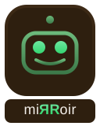
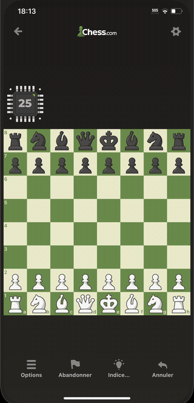

<p align="center">
  
</p>

# mirroir-mcp

[](https://www.npmjs.com/package/mirroir-mcp)
[](https://github.com/jfarcand/mirroir-mcp/actions/workflows/build.yml)
[](LICENSE)
[](https://support.apple.com/en-us/120421)
[](https://discord.gg/u8ug9QCSqF)

### Let your agent use your real iPhone: errands across your apps, automations, even games.

<p align="center">
  <a href="https://mirroir.dev/?utm_source=github&utm_medium=readme&utm_campaign=header">Website</a> ·
  <a href="https://mirroir.dev/?utm_source=github&utm_medium=readme&utm_campaign=header#demo">Demos</a> ·
  <a href="docs/onboarding.md">Set up with your agent</a> ·
  <a href="docs/tools.md">Tools</a> ·
  <a href="CHANGELOG.md">Changelog</a> ·
  <a href="https://discord.gg/u8ug9QCSqF">Discord</a>
</p>

<p align="center">
  
</p>
<p align="center"><em>"Be my DJ": the agent asks for a vibe, builds a Gui Boratto-style playlist in Spotify and starts it. A real iPhone, sped up.</em></p>

No Developer Mode, no Xcode, no WebDriverAgent, no jailbreak. mirroir-mcp drives your iPhone through macOS iPhone Mirroring, with the apps already signed in on it, from any MCP client: [42 tools](docs/tools.md).

mirroir-mcp is an MCP server, with a framework on top: what an agent does once becomes a [skill](docs/skills-and-ci.md#skills) and a test that replay without an LLM.

<p align="center">
  
</p>
<p align="center"><em>A saved recipe reel becomes a grocery list: the agent <a href="docs/tools.md#listening">listens</a> to the video and reads its frames. Sped up.</em></p>

<p align="center">
  
</p>
<p align="center"><em>Chess against Chess.com's strongest bot: the model reads the board, Stockfish picks, mirroir plays. See <a href="docs/games.md">Games</a>. Sped up.</em></p>

## Quick start

You need macOS 15 or later and an iPhone connected through [iPhone Mirroring](https://support.apple.com/en-us/120421). Paste this into your coding agent (Claude Code, Codex, Cursor, OpenClaw, …):

```text
Set up mirroir-mcp so you can drive my iPhone: follow https://github.com/jfarcand/mirroir-mcp/blob/main/docs/onboarding.md step by step, and finish by reading back what my iPhone screen shows.
```

Or install it yourself:

```bash
npx -y mirroir-mcp install    # or: brew tap jfarcand/tap && brew install mirroir-mcp
npx -y mirroir-mcp doctor     # names anything left to fix
```

OpenClaw, Hermes Agent, Claude Desktop, Cursor, VS Code and the other clients: [Install](docs/install.md).

## What you get

- **Any app, nothing on the phone.** If iPhone Mirroring shows it, mirroir can drive it. The phone stays stock.
- **Proven steps in one call.** [`run_steps`](docs/tools.md#tool-list) replays a sequence that worked, checked against the permission policy first.
- **Skills and tests without an LLM.** `generate_skill` explores an app and writes [SKILL.md](docs/skills-and-ci.md#skills) files; `mirroir test` replays them in CI. [`mirroir-run`](docs/mirroir-run.md) runs one scenario across iPhone, web and HTTP, with a `DRIFT` verdict (exit 65).
- **Remote agents.** [`mirroir-mcp serve`](docs/cli.md#serve) speaks MCP over HTTP on loopback, behind a bearer token.

## Safety

- **Read-only by default.** Only the 14 read-only tools are exposed until you allow more in [`permissions.json`](docs/permissions.md); `blockedApps` keeps agents out of apps like Wallet.
- **Passwords stay yours.** mirroir never presses a password or Touch ID sheet.
- **No telemetry.** The only default network call is a daily version check (`updateCheck: false` turns it off).
- **Kill switch.** Quit iPhone Mirroring, lock the Mac or quit the MCP client: input stops at once.

See [Security](docs/security.md) and [SECURITY.md](SECURITY.md).

## Documentation

| | |
|---|---|
| [Install](docs/install.md) | Every install path, per-client setup, updating, uninstalling |
| [Onboarding](docs/onboarding.md) | Setup written for the agent: prerequisites, install, doctor, a read-only proof, and an optional first errand |
| [Tools Reference](docs/tools.md) | All 42 tools, parameters, and input workflows |
| [How mirroir sees the screen](docs/screen-intelligence.md) | The observe, reason, act loop; OCR, icon detection, AI vision |
| [Skills, exploration and CI](docs/skills-and-ci.md) | APP.md, skills, `generate_skill`, `mirroir test`, compiled replay, AI diagnosis, patterns |
| [`mirroir-run`](docs/mirroir-run.md) | Replay across iPhone, web, HTTP and subprocesses; GitHub Actions; Maestro import |
| [Games](docs/games.md) | Shell and scene, the `scene:` step, game controls |
| [CLI Tools](docs/cli.md) | Recorder, doctor, keyboard layout, `serve` over HTTP |
| [Configuration](docs/configuration.md) | All settings: screen intelligence, input timing, exploration, AI providers |
| [FAQ](docs/faq.md) | Security, focus stealing, keyboard layouts, embacle/vision mode |
| [Security](docs/security.md) | Threat model, kill switch, and recommendations |
| [Privacy](docs/privacy.md) | What mirroir reads, sends and stores |
| [Permissions](docs/permissions.md) | Fail-closed permission model and config file |
| [Known Limitations](docs/limitations.md) | Focus stealing, keyboard layout gaps, autocorrect |
| [Patterns & Skills](docs/components.md) | Element patterns, screen recipes, APP.md app descriptions, and the detection pipeline |
| [Exploring a New App](docs/exploring-a-new-app.md) | Step-by-step playbook for onboarding a new app — APP.md, permissions, components, exploration goal |
| [YOLO Icon Detection](docs/yolo-models.md) | Recommended YOLO models, CoreML setup, and configuration |
| [Compiled Skills](docs/compiled-skills.md) | Skill replay without AI |
| [Testing](docs/testing.md) | FakeMirroring, integration tests, and CI strategy |
| [Web and iOS in one scenario](docs/web-and-ios.md) | How `mirroir-run` hands iOS blocks to `mirroir-mcp`, and how `cross_surface` compares a browser with a phone |
| [Cross-surface replay](runner/docs/) | `mirroir-run` scenario grammar, `.mirroir/` plan, `SAMPLE.md`, judge profiles, CI |
| [Troubleshooting](docs/troubleshooting.md) | Debug mode and common issues |
| [Contributing](CONTRIBUTING.md) | How to add tools, commands, and tests |
| [Skills Marketplace](docs/skills-marketplace.md) | Skill format, plugin discovery, and authoring |

## Community

Join the [Discord server](https://discord.gg/u8ug9QCSqF) to ask questions, share skills, and discuss ideas. Pull requests are welcome: see [CONTRIBUTING.md](CONTRIBUTING.md). Report a vulnerability privately: see [SECURITY.md](SECURITY.md). By submitting a patch, you agree to the [Contributor License Agreement](CLA.md); your Git commit metadata serves as your electronic signature.

## License

Apache 2.0 - Copyright 2026 [Async-IO](https://async-io.live).

---

> **Why "mirroir"?** — It's the old French spelling of *miroir* (mirror). A nod to the author's roots, not a typo.
