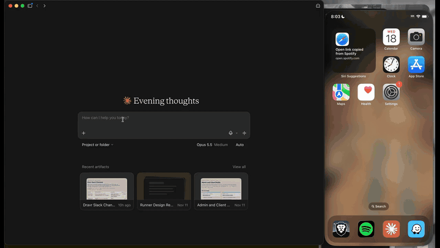
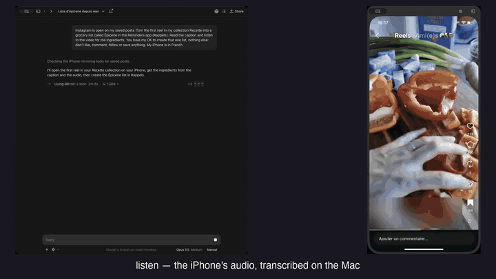

<p align="center">
  
</p>

# mirroir-mcp

[](https://www.npmjs.com/package/mirroir-mcp)
[](https://github.com/jfarcand/mirroir-mcp/actions/workflows/build.yml)
[](LICENSE)
[](https://support.apple.com/en-us/120421)
[](runner/README.md)
[](https://discord.gg/u8ug9QCSqF)

### Let your agent use your real iPhone: errands across your apps, automations, even games.

**Your phone. Your apps. Your agent.** Cloud phone services rent you a phone. mirroir drives the one in your pocket, and turns what your agent does once into skills and tests you keep.

<p align="center">
  <a href="https://mirroir.dev/?utm_source=github&utm_medium=readme&utm_campaign=header">Website</a> ·
  <a href="https://mirroir.dev/?utm_source=github&utm_medium=readme&utm_campaign=header#demo">Demos</a> ·
  <a href="docs/onboarding.md">Set up with your agent</a> ·
  <a href="docs/tools.md">Tools</a> ·
  <a href="CHANGELOG.md">Changelog</a> ·
  <a href="https://discord.gg/u8ug9QCSqF">Discord</a>
</p>

<p align="center">
  
</p>
<p align="center"><em>"Be my DJ": the agent asks for a vibe, builds a Gui Boratto-style playlist in Spotify and starts it. A real iPhone, sped up.</em></p>

No Developer Mode, no Xcode, nothing installed on the phone. mirroir-mcp drives your iPhone through macOS iPhone Mirroring, with the apps already signed in on it: no connector, no OAuth, no password handed to anyone. It works with Claude, Codex, Cursor and other AI apps that support MCP, through [42 tools](docs/tools.md).

## Quick start

You need macOS 15 or later and an iPhone connected through [iPhone Mirroring](https://support.apple.com/en-us/120421). Paste this into your coding agent (Claude Code, Codex, Cursor, OpenClaw, …):

```text
Set up mirroir-mcp so you can drive my iPhone: follow https://github.com/jfarcand/mirroir-mcp/blob/main/docs/onboarding.md step by step, and finish by reading back what my iPhone screen shows.
```

Or install it yourself:

```bash
npx -y mirroir-mcp install    # or: brew tap jfarcand/tap && brew install mirroir-mcp
npx -y mirroir-mcp doctor     # names anything left to fix
```

OpenClaw, Hermes Agent, Claude Desktop, Cursor, VS Code and the other clients: [Install](docs/install.md).

## How it works

```text
your agent ──MCP──▶ mirroir ──iPhone Mirroring──▶ your iPhone
                       │
   explore ──▶ SKILL.md ──▶ compile ──▶ replay, no LLM ──▶ CI: pass · fail · DRIFT
```

Your agent drives the phone through mirroir's tools. What it learns stays: an exploration becomes a skill, a skill compiles to a replay that needs no model, and the replay runs in CI.

## How it reads the screen

`describe_screen` is the agent's eyes, and it has two modes. One setting, `screenDescriberMode` in [`settings.json`](docs/configuration.md), picks between them.

| | Local OCR (default) | AI vision |
|---|---|---|
| What it reads | Text, with exact tap points ([Apple Vision OCR](docs/screen-intelligence.md#apple-vision-ocr-default)); icons through an on-device [YOLO model](docs/yolo-models.md) | Text and icons by name ("Wi-Fi", "Spotify"), including faint labels and on/off states OCR can miss |
| Where it runs | On your Mac, free | Through your agent ([`embacle`](docs/screen-intelligence.md#ai-vision-mode-embacle) by default), about 25k tokens and a few seconds per read |
| Tap points | Exact | Approximate, so check before tapping near the bottom of the screen |
| Setting | `"screenDescriberMode": "ocr"` | `"screenDescriberMode": "vision"` |

Start with OCR. Switch to vision when the screen is mostly icons, or its text is too faint for OCR.

## The framework

- **[Tools](docs/tools.md).** 42 MCP tools: tap, type, swipe, read the screen, listen, launch, and [`run_steps`](docs/tools.md#tool-list) to repeat a sequence in one call.
- **[Skills](docs/skills-and-ci.md#skills).** `generate_skill` explores an app and writes SKILL.md files your agent follows.
- **[Compiled replay](docs/compiled-skills.md).** `mirroir test` replays a skill from the CLI with no AI in the loop: deterministic, no tokens.
- **[App knowledge](docs/APP.md.spec.md).** APP.md files and [screen recipes](docs/components.md#screen-patterns-recipes) describe an app's screens once, for every agent.
- **[mirroir-run](docs/mirroir-run.md).** One YAML scenario drives the iPhone, a browser, HTTP and subprocesses, with a third verdict beside pass and fail: `DRIFT` (exit 65), when the output moved past its baseline.
- **Notes and sharing.** `save_note` keeps one lesson per app for the next session; [`mirroir-mcp serve`](docs/cli.md#serve) shares the phone over HTTP.

## More demos

<p align="center">
  
</p>
<p align="center"><em>A saved recipe reel becomes a grocery list: the agent <a href="docs/tools.md#listening">listens</a> to the video and reads its frames. Sped up.</em></p>

<p align="center">
  
</p>
<p align="center"><em>Chess against Chess.com's strongest bot: the model reads the board, Stockfish picks, mirroir plays. See <a href="docs/games.md">Games</a>. Sped up.</em></p>

<table align="center">
  <tr>
    <td align="center" width="50%">
      <br />
      <em>Reads the ETA in Waze, posts it in Slack.</em>
    </td>
    <td align="center" width="50%">
      <br />
      <em>Tests a login screen in Expo Go.</em>
    </td>
  </tr>
</table>

## Why mirroir

- **Nothing to install on the phone.** The iPhone stays stock: no signing, no provisioning profile, no on-device agent.
- **Your Mac stays yours.** Through macOS 26, taps, typing and swipes reach the mirror without bringing it to the front, so you can keep working; on later macOS they bring it forward.
- **It hears the phone, too.** [`listen`](docs/tools.md#listening) turns what the phone plays, a reel's narration or a voice message, into text. macOS transcribes it on the Mac: the audio never leaves it. Needs macOS 26.

## Safety

- **Read-only by default.** Only the 14 read-only tools are exposed until you allow more in [`permissions.json`](docs/permissions.md); `blockedApps` keeps agents out of apps like Wallet.
- **Passwords stay yours.** mirroir never presses a password or Touch ID sheet.
- **No telemetry.** The only default network call is a daily version check (`updateCheck: false` turns it off).
- **Kill switch.** Quit iPhone Mirroring, lock the Mac or quit the MCP client: input stops at once.

See [Security](docs/security.md) and [SECURITY.md](SECURITY.md).

## Documentation

| | |
|---|---|
| [Install](docs/install.md) | Every install path and per-client setup |
| [Tools](docs/tools.md) | What each tool does, with its parameters |
| [Skills and CI](docs/skills-and-ci.md) | Skills, `generate_skill`, `mirroir test` |
| [Games](docs/games.md) | Playing games, frame by frame |
| [Security](docs/security.md) and [permissions](docs/permissions.md) | What mirroir can do, and how to limit it |
| [Troubleshooting](docs/troubleshooting.md) | Debug mode and common issues |

Everything else: [docs/](docs/).

## Community

Join the [Discord server](https://discord.gg/u8ug9QCSqF) to ask questions and share skills. Pull requests are welcome: see [CONTRIBUTING.md](CONTRIBUTING.md). Report a vulnerability privately: see [SECURITY.md](SECURITY.md).

## License

Apache 2.0 - Copyright 2026 [Async-IO](https://async-io.live).

---

> **Why "mirroir"?** — It's the old French spelling of *miroir* (mirror). A nod to the author's roots, not a typo.
