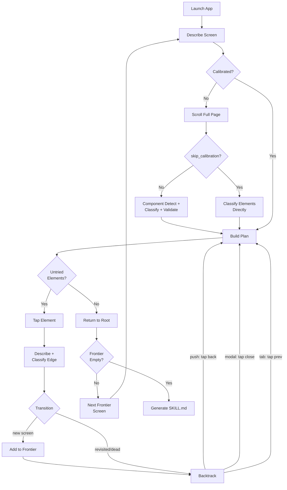

# Skills, exploration and CI

Describe an app, capture a workflow as a skill, explore an app into skills, replay them with no AI in the loop, and diagnose failures.

## Describe Your App

mirroir can explore any iOS app blindly, but it works better when you tell it what to expect. Write an `APP.md` file and mirroir reads it before exploration starts:

```markdown
---
app: Santé
archetype: dashboard
obstacle_mode: auto
---

## Structure
Dashboard with 4 tabs: Résumé, Partage, Parcourir, Profil.

## Résumé Tab
- Summary cards for health metrics that drill down to charts
- Cards often show "Aucune donnée" on test devices

## Obstacles
- Health Access permission → tap "Autoriser"
- Notification permission → tap "Ne pas autoriser"

## Skip
- Supprimer les données de Santé
- Réinitialiser
```

What the code actually uses today: `archetype` overrides recipe auto-detection; `obstacles` are auto-dismissed when `obstacle_mode: auto`; `skip` merges with `permissions.json.skipElements`; `tabs` (inline or as a section) are injected as high-priority targets; Structure + tab body + Tips become AI context in generated skills.

See the [APP.md specification](APP.md.spec.md) for the complete field list, loader resolution rules, and the permission-system bridge. Three levels of patterns work together — elements (what rows look like), screens (what the page layout means), and apps (what the developer knows). [Patterns & Skills](components.md) covers the full system.

## Skills

When you find yourself repeating the same agent workflow, capture it as a skill. Skills are SKILL.md files — numbered steps the AI follows, adapting to layout changes and unexpected dialogs. Steps like `Tap "Email"` use OCR — no hardcoded coordinates.

Place files in `~/.mirroir-mcp/skills/` (global) or `<cwd>/.mirroir-mcp/skills/` (project-local).

### APP.md

Describe your app's structure to guide exploration — see [Describe Your App](skills-and-ci.md#describe-your-app) above and the full [APP.md specification](APP.md.spec.md). Place APP.md files in `~/.mirroir-mcp/skills/` or the [mirroir-skills](https://github.com/jfarcand/mirroir-skills) repo at `patterns/apps/`.

```markdown
---
version: 1
name: Commute ETA Notification
app: Waze, Messages
tags: ["workflow", "cross-app"]
---

## Steps

1. Launch **Waze**
2. Wait for "Où va-t-on ?" to appear
3. Tap "Où va-t-on ?"
4. Wait for "${DESTINATION:-Travail}" to appear
5. Tap "${DESTINATION:-Travail}"
6. Wait for "Y aller" to appear
7. Tap "Y aller"
8. Wait for "min" to appear
9. Remember: Read the commute time and ETA.
10. Press Home
11. Launch **Messages**
12. Tap "New Message"
13. Type "${RECIPIENT}" and select the contact
14. Type "On my way! ETA {eta}"
15. Press **Return**
16. Screenshot: "message_sent"
```

`${VAR}` placeholders resolve from environment variables. `${VAR:-default}` for fallbacks.

### Skill Marketplace

Install ready-to-use skills from [jfarcand/mirroir-skills](https://github.com/jfarcand/mirroir-skills):

```bash
git clone https://github.com/jfarcand/mirroir-skills ~/.mirroir-mcp/skills
```

## From Exploration to CI

The `generate_skill` tool lets an AI agent explore an app and produce SKILL.md files. It uses [breadth-first search](https://en.wikipedia.org/wiki/Breadth-first_search) (BFS) to traverse the app as a navigation graph — screens are nodes, tappable elements are edges. The explorer describes each screen, matches elements against [component definitions](components.md) to decide what to tap, visits child screens, and backtracks via the back chevron. Duplicate screens are skipped via structural fingerprinting. See [Component Detection](components.md) below for how the explorer interprets raw elements into structured UI components.

The explorer works viewport-by-viewport: after calibrating the page length, it builds a plan from the current viewport, taps elements top-to-bottom, scrolls down to reveal more content, and rebuilds the plan for each new viewport. This approach works with both OCR and AI vision describers. Pass `seed` for deterministic ordering across runs.

Exploration is bounded — it does not discover every reachable screen in large apps. Depth, screen count, and time limits keep runs practical. For targeted flows, provide a `goal` to focus the traversal.



### Generate

Two modes: **autonomous exploration** (BFS) and **guided session** (manual step-by-step).

**Autonomous BFS exploration** — the agent explores on its own:

```
Explore the Settings app and generate a skill that checks the iOS version.
```

This calls `generate_skill(action: "explore", app_name: "Settings", goal: "check iOS version")` under the hood. The explorer launches the app, runs BFS from the root screen, and outputs a SKILL.md for the discovered path.

| Parameter | Default | Description |
|-----------|---------|-------------|
| `app_name` | required | App to explore |
| `goal` | none | Focus exploration toward a specific flow (e.g. "check software version") |
| `goals` | none | Array of goals — one SKILL.md per goal |
| `max_depth` | 6 | Maximum BFS depth |
| `max_screens` | 30 | Maximum screens to visit |
| `max_time` | 300 | Maximum seconds before stopping |
| `strategy` | auto | `"mobile"` (default), `"social"` (Reddit, Instagram, TikTok), or `"desktop"` (macOS windows) |
| `explorer` | `bfs` | Exploration algorithm: `"bfs"` (breadth-first, default) or `"dfs"` (depth-first) |
| `skip_calibration` | false | Skip component detection during calibration. Scrolling still runs. Useful with AI vision describers that produce clean semantic elements |
| `seed` | random | Integer seed for deterministic exploration ordering. Same seed produces identical tap sequences |
| `fresh` | true | Discard persisted navigation graph and explore from scratch. Set `false` for incremental exploration |

**Guided session** — the AI navigates manually, capturing each screen:

1. `generate_skill(action: "start", app_name: "MyApp")` — launch app, OCR first screen
2. Use `tap`/`swipe`/`type_text` to navigate, then `generate_skill(action: "capture")` to record each screen
3. `generate_skill(action: "finish")` — assemble captured screens into a SKILL.md

### Test

Run skills deterministically from the CLI — no AI in the loop. A YAML skill runs its own steps. A SKILL.md's body is prose for an AI, so it runs the steps recorded in its `.compiled.json` when an MCP client first ran it (`get_skill`, then `record_step` after each step and `save_compiled` at the end). An uncompiled SKILL.md is refused with that instruction, one edited since it was compiled is refused as stale, and a run with no skill arguments skips any SKILL.md that has no compiled file:

```bash
mirroir test apps/settings/check-about
mirroir test --junit results.xml --verbose        # JUnit output
mirroir test --dry-run apps/settings/check-about    # validate without executing
```

| Option | Description |
|---|---|
| `--junit <path>` | Write JUnit XML report |
| `--report-json <path>` | Write a Playwright JSON-reporter document — the format `mirroir-run` ingests |
| `--capture <key>` | Attach each skill's final-screen OCR text to the `--report-json` document under `cross_surface.<key>`, with the structural fingerprint of the start screen and of each step's settled screen under `screens` (`start`, `0`, `1`, …) and the window under `device` |
| `--compiled-out <path>` | After the one skill given passes, write its `.compiled.json` to `<path>`: each step that ran as a passthrough step carrying the screen it left (`arrivalFingerprint`), the start screen as `screenFingerprint`. A failed run, or a pass whose start screen or any step's screen could not be read, writes nothing and exits `1`. Needs `--compiled-source`; refused with `--dry-run` or more than one skill |
| `--compiled-source <file>` | The file whose SHA-256 the `--compiled-out` skill records as its source — the scenario `mirroir-run` rendered the skill from |
| `--screenshot-dir <dir>` | Save failure screenshots (default: `./mirroir-test-results/`) |
| `--timeout <seconds>` | `wait_for` timeout (default: 15) |
| `--verbose` | Step-by-step detail |
| `--dry-run` | Parse and validate without executing (refused with `--report-json`: a dry run has no verdict to report) |
| `--confirm-destructive` | Run steps that send, remove, spend, or reset something on the device. Without it, a run holding one is refused before any step executes, naming each. `reset_app:` counts as destructive except when the very next step is a `launch:` of the same app (exact name, case-sensitive after trimming): that pair only returns the app about to be driven to its root, the way every emitted `.ios.yaml` flow opens |
| `--no-compiled` | Skip compiled skills, force full OCR |
| `--agent <name>` | AI diagnosis of a failed step (see [AI-Assisted Diagnosis](skills-and-ci.md#ai-assisted-diagnosis)) |

Exit code `0` = all pass, `1` = any failure, `2` = refused arguments (an unknown option is named, never ignored). A skill whose every step was skipped is a failure, and a skill holding a step the parser cannot read (an unknown verb, a malformed `target:`) or cannot use (a `drag:` naming neither end, a `measure:` with no action) is refused before anything runs, `--dry-run` included. A skill holding an AI-only step (`verify`, `remember`, `condition`, `repeat`, `summarize`) fails with `not evaluated: <step> needs an AI client`: the CLI has no AI to check it, so it never reports that skill as passed.

`mirroir test` only reads `.compiled.json` files, never rewrites them; it writes one only to the path `--compiled-out` names. A compiled file stale for its source, format version or window size is named and the skill runs on live OCR.

### Compiled Skills

Compile a skill once to capture coordinates and timing. Replay skips OCR for every step with a recorded hint; assertions still re-check the screen, and steps without a hint run live.

```bash
mirroir compile apps/settings/check-about        # compile
mirroir test apps/settings/check-about            # auto-detects .compiled.json
mirroir test --no-compiled check-about            # force full OCR
```

`mirroir compile` re-records coordinates by running a skill's steps on the device. For a SKILL.md those are the steps in its existing `.compiled.json`, so the first compile of a SKILL.md always happens through an MCP client.

An AI agent compiles a skill on its first MCP run by calling `record_step` after each step and `save_compiled` at the end. See [Compiled Skills](compiled-skills.md) for details.

Two different files are named `.compiled.json`. The one next to a skill, written by `save_compiled` or `mirroir compile`, is the speed cache `mirroir test` replays. The `<scenario>.compiled.json` next to an `.ios.yaml` in a consumer repo's `.mirroir/` is the screen-drift baseline `mirroir-run` records itself on a passing run; the runner never replays from it, every `ios` block runs live. So `save_compiled` with `emit: true` writes the skill's `.compiled.json` and a `.mirroir/` scenario, never a `.compiled.json` into `.mirroir/`.

### AI-Assisted Diagnosis

When a test step fails, pass `--agent` to get an AI diagnosis of what went wrong and suggested fixes:

```bash
mirroir test --agent gpt-5.3 apps/settings/check-about
mirroir test --agent claude-sonnet-5-5 apps/settings/check-about
mirroir test --agent ollama:llama3 apps/settings/check-about
mirroir test --agent embacle apps/settings/check-about
```

Built-in agents:

| Agent | Provider | API Key |
|-------|----------|---------|
| `gpt-5.3` | OpenAI | `OPENAI_API_KEY` |
| `claude-opus-5-5`, `claude-sonnet-5-5`, `claude-haiku-5-5` | Anthropic | `ANTHROPIC_API_KEY` |
| `ollama:<model>` | [Ollama](https://ollama.com) (local) | None |
| `embacle`, `embacle:claude` | [embacle-server](https://github.com/dravr-ai/dravr-embacle) | CLI agent key |

How a request reaches its agent: Anthropic, OpenAI and Ollama agents always call their own HTTP API. An `embacle` agent whose model is a bare Copilot model id (`embacle` sends `claude-sonnet-5.5`) runs on the embedded embacle runtime when `libembacle` is linked and `agentTransport` is not `"http"`, and over HTTP to `base_url` otherwise. An embacle model in embacle-server's `runner:model` form always goes over HTTP, because the embedded runtime is the Copilot runner only: `embacle:claude` sends `claude:sonnet`, which selects embacle-server's Claude Code runner, so it needs `embacle-server` listening on `http://localhost:3000`. A bare runner name as the model (`claude`, `copilot`, …) means that runner's default model and also goes over HTTP.

Custom agents are defined as YAML profiles in `<cwd>/.mirroir-mcp/agents/<name>.yaml` (project-local) or `~/.mirroir-mcp/agents/<name>.yaml` (global, project-local wins). Pass the file's `<name>` to `--agent`.

A profile runs in one of two modes:

**`mode: api`** — call a cloud or local HTTP endpoint:

```yaml
# ~/.mirroir-mcp/agents/my-gpt.yaml
mode: api
provider: openai          # anthropic | openai | ollama | embacle
model: gpt-5.3
api_key_env: OPENAI_API_KEY
base_url: https://api.openai.com
system_prompt: "You are a terse iOS automation debugger."
max_tokens: 4096
```

**`mode: command`** — run a local CLI process (e.g. an already-authenticated `claude -p` / `copilot -p`, or a custom script). The diagnostic payload is delivered two ways: if any `args` entry contains `${PAYLOAD}`, the JSON payload is substituted there; otherwise it is piped to the command's stdin:

```yaml
# ~/.mirroir-mcp/agents/claude-cli.yaml
mode: command
command: claude
args: ["-p", "${PAYLOAD}"]
system_prompt: "Diagnose the failed step and reply with JSON."
```

| Key | Mode | Description |
|---|---|---|
| `mode` | both | `api` (default) or `command` |
| `provider` | api | `anthropic`, `openai`, `ollama`, or `embacle` |
| `model` | api | Model identifier |
| `api_key_env` | api | Environment variable holding the API key |
| `base_url` | api | Endpoint base URL |
| `command` | command | Executable to launch (`PATH`-resolved, or an absolute path) |
| `args` | command | Argument array; `${PAYLOAD}` is replaced with the JSON payload |
| `system_prompt` | both | System prompt sent with the request |
| `max_tokens` | both | Response token budget |

<details>
<summary>No API key? Use embacle</summary>

[embacle](https://github.com/dravr-ai/dravr-embacle) routes requests through already-authenticated CLI tools (GitHub Copilot, Claude Code, etc.) — no separate API key needed:

```bash
brew tap dravr-ai/tap && brew trust --tap dravr-ai/tap && brew install embacle
mirroir test --agent embacle my-skill
```

</details>

### Pattern System

The explorer uses a three-layer pattern system to understand iOS apps — the same declarative concept at different scales:

- **Element patterns** (`patterns/elements/`) — 34 definitions matching row-level UI components (table rows, tab bars, toggles, summary cards). Each specifies match rules, interaction behavior, and grouping logic.
- **Screen patterns** (`patterns/screens/`) — 7 archetype recipes that identify screen-level navigation models from element composition. Auto-detected during calibration, or declared via `archetype` in APP.md.
- **App patterns** (`patterns/apps/`) — APP.md files with structure, obstacles, skip lists, and archetype declarations. The developer's source of truth.

Built-in archetypes: `settings-list`, `dashboard`, `social-feed`, `content-grid`, `conversation-list`, `utility-display`, `detail-form`.

Place custom patterns in `~/.mirroir-mcp/components/` (elements), `~/.mirroir-mcp/recipes/` (screens), or the [mirroir-skills](https://github.com/jfarcand/mirroir-skills) repo.

#### Vision Indicators

AI vision describers describe UI elements semantically ("Activité chevron") rather than character-by-character ("Activité" + ">"). A `vision-indicators.md` file maps these descriptions to OCR-compatible characters so the component pipeline works identically with both backends:

```markdown
## Indicators
- chevron: >
- dismiss: ×
- back: <
```

When a vision element ends with a mapped suffix (e.g. "Entraînements chevron"), the normalizer splits it into two elements: "Entraînements" + ">". Place `vision-indicators.md` alongside your component definitions.

See [Component Detection](components.md) for the full definition format, match rule reference, and the detection pipeline.
